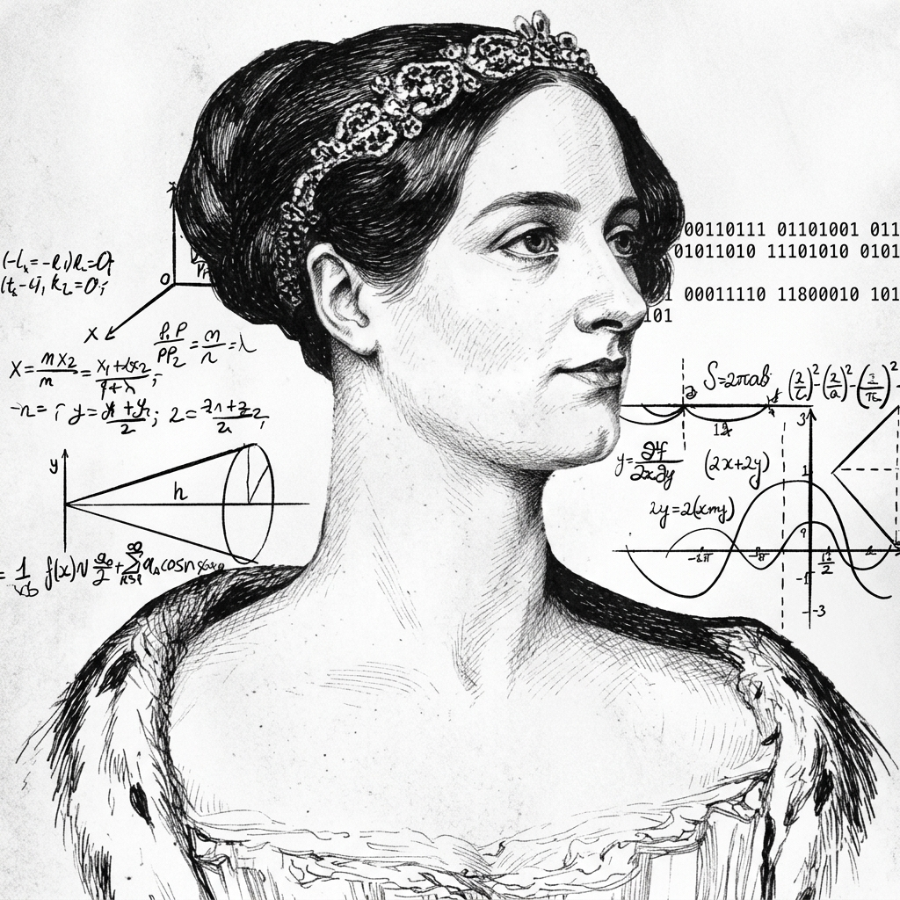
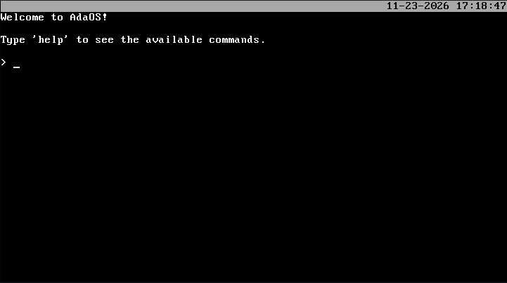

<p align="center">
  
</p>

<h1 align="center">AdaOS</h1>

AdaOS is a tiny command-line operating system for 32-bit x86, written in C and Assembly. It boots through GRUB and drops you into a DOS-style shell.

<p align="center">
  
</p>

<p align="center">Shell of AdaOS, since the commit <a href="https://github.com/TayebYassine/AdaOS/commit/e2afe864216822b3299b83d69f097a2bba21f8e5"> e2afe86</a>.</p>

> [!CAUTION]
> AdaOS is a hobby project, not an official product. It's experimental and may have bugs.
> Run it in a virtual machine such as [VirtualBox](https://www.virtualbox.org/) or [QEMU](https://www.qemu.org/) rather than on real hardware.

## Minimum requirements

AdaOS boots from the ISO through a multiboot loader. The kernel runs from RAM; the file system is kept on the first IDE disk when there is one, so files survive a reboot, and stays in RAM when there is not.

| Component  | Minimum                           | Notes                                                                                                                                  |
|------------|-----------------------------------|----------------------------------------------------------------------------------------------------------------------------------------|
| CPU        | 32-bit x86 (i386 or newer)        | Runs in 32-bit protected mode; x86-64 CPUs work in their legacy 32-bit mode                                                            |
| Firmware   | Legacy BIOS (or CSM)              | **No UEFI support** — an EFI-only machine will not boot the ISO                                                                        |
| RAM        | 32 MB                             | The kernel is ~172 KB loaded at 1 MiB with a 16 KB stack; a physical memory manager, paging and a kernel heap manage the RAM beyond it |
| Boot media | CD/DVD drive, or USB stick        | `adaos.iso` is a hybrid image: writing it to a USB stick with `dd` also boots on BIOS machines                                         |
| Display    | VGA-compatible adapter, text mode | Text mode only (80x25), no graphics mode and no graphics driver                                                                        |
| Keyboard   | PS/2 keyboard                     | Scancode set 1 via IRQ1; USB keyboards only work where the firmware or VM emulates PS/2                                                |
| Storage    | IDE disk (optional)               | The first ATA disk on the primary IDE bus holds the file system: 128 entries, the whole tree rewritten on every change. Without a disk the tree lives in RAM for the session |

AdaOS has been tested with QEMU (`qemu-system-i386`) and VirtualBox 7.2. In VirtualBox use the `Other` (32-bit) type, BIOS firmware (not EFI), an IDE controller and 32 MB of RAM or more.

## Commands

| Command           | Description                                     |
|-------------------|-------------------------------------------------|
| `cat <path>`      | Print a file                                    |
| `cd <path>`       | Change the current directory                    |
| `clear`           | Clear the screen                                |
| `disk`            | Show the disk and its file system               |
| `help`            | List available commands                         |
| `ls [path]`       | List a directory                                |
| `mem`             | Show RAM, paging, the heap and the kernel size  |
| `mkdir <path>`    | Create a directory                              |
| `print <text>`    | Print text to the screen                        |
| `pwd`             | Show the current directory                      |
| `reboot`          | Restart the machine                             |
| `rm <path>`       | Remove a file or a directory and its contents   |
| `setdate`         | Set the date                                    |
| `settime`         | Set the time of day                              |
| `shutdown`        | Power off the machine                           |
| `sleep <sec>`     | Pause for a number of seconds                   |
| `snake`           | Play the snake game                             |
| `tasks`           | Show the running tasks                          |
| `time`            | Show the date and the time                      |
| `uptime`          | Show how long AdaOS has been running            |
| `write <file>`    | Edit a file in the full-screen editor           |

## File system

Paths work the way a DOS-era shell's do: `cd`, `ls`, `mkdir` and `rm` walk a
tree rooted at `/`, and the tree starts with the contents of `files/`, packed
into `init.tar` and handed to the kernel by the bootloader. `write` opens the
editor, where `^S` saves and `^E` exits; every command that changes the tree is
followed by a save to the disk, and a blank disk is formatted on first boot.

## Building

Requirements: `gcc` (with 32-bit support), `nasm`, `ld`, `grub-mkrescue`, `xorriso`, and QEMU or VirtualBox.

```bash
./build-iso.sh
qemu-system-i386 -cdrom adaos.iso
```
